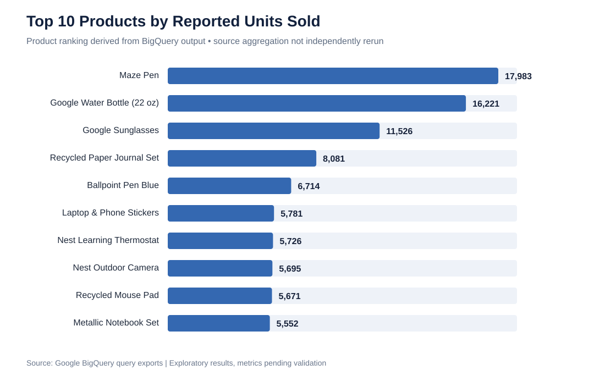
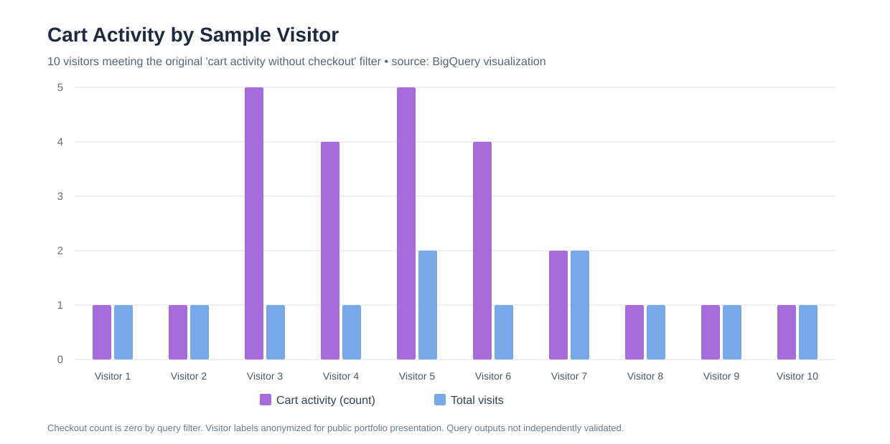

# E-commerce Sales & Conversion Analysis

An exploratory SQL portfolio project using **Google BigQuery** to investigate e-commerce sales patterns, customer shopping activity, product performance, and traffic-source conversion.

## Project overview

The project uses the public `data-to-insights.ecommerce.all_sessions` dataset to answer five business questions through SQL queries and visual summaries.

**Tools:** Google BigQuery · Standard SQL · CSV exports · Data visualization

### Project scope

This project demonstrates exploratory e-commerce data analysis using Google BigQuery and SQL. It includes queries covering revenue distribution, product performance, customer activity, transaction-session activity, and traffic-channel conversion.

The repository contains SQL scripts, selected result summaries, and visualizations created from query outputs.

## Analyses

| Business question | SQL query | Exported results |
| --- | --- | --- |
| Which cities have the highest reported revenue? | [Revenue by city](sql/01_revenue_by_city.sql) | [Top 10 cities](results/revenue_by_city_top10.csv) |
| Which visitors show cart activity without checkout? | [Cart and checkout activity](sql/02_cart_without_checkout_by_visitor.sql) | [Aggregate summary](results/cart_without_checkout_summary.csv) |
| What proportion of counted sessions show a transaction? | [Transaction-session percentage](sql/03_transaction_session_percentage.sql) | [Single KPI result](results/transaction_session_percentage.csv) |
| How does calculated conversion vary by traffic channel? | [Channel conversion](sql/04_traffic_channel_conversion.sql) | [Channel summary](results/traffic_channel_conversion.csv) |
| Which products have the most reported units sold? | [Top products](sql/05_top_products_by_units_sold.sql) | [Top 10 products](results/top10_products.csv) |

The city-level SQL covers all available cities; its visualization highlights the top 10 to improve readability. The cart analysis is visitor-level and is not presented as a validated cart-abandonment rate.

## Visualizations

### Top 10 cities by reported revenue


### Top 10 products by reported units sold



### Traffic-channel conversion rates


### Cart activity — 10 visitor samples



This SVG recreates the supplied BigQuery cart-activity chart with anonymized visitor labels. It is illustrative of the ten displayed visitor records, not a population-level cart-abandonment metric.

These SVG visualizations were created from BigQuery result exports.

## Selected findings from the query outputs

- **Geographic revenue:** New York, Mountain View, and San Francisco ranked highest in the exported city results.
- **Product sales:** Maze Pen (17,983) and Google 22 oz Water Bottle (16,221) led the exported top-products ranking.
- **Transaction sessions:** The query returned **4.48%** under its current counting definition.
- **Channel conversion:** The reported results included Referral (**11.89%**), Direct (**6.54%**), and Organic Search (**1.56%**).
- **Cart activity:** The original query returned **28,149 visitor-level records** with cart activity and no recorded checkout action under its filter.

**Metric interpretation:** These are exploratory query outputs, not audited business KPIs. Revenue units, row-level duplication, session identifiers, event definitions, and conversion calculations still need validation. See [Metric definitions and validation](docs/metric_validation.md) before relying on any figure.

## Repository structure

```text
.
├── README.md
├── sql/                 # Five BigQuery SQL analyses
├── results/             # Shareable result summaries
├── visualizations/      # Charts based on exported results
└── docs/
    └── metric_validation.md
```

## Reproduce the analysis

1. Open [Google BigQuery](https://console.cloud.google.com/bigquery) with an accessible Google Cloud project.
2. Confirm that the public table `data-to-insights.ecommerce.all_sessions` is available.
3. Run the queries in the [`sql/`](sql/) folder using Standard SQL.
4. Compare the outputs against the [`results/`](results/) summaries and review metric definitions before drawing conclusions.

The SQL files preserve the original exploratory calculations captured in BigQuery query screenshots and have not been independently re-executed during repository preparation. Running BigQuery queries may incur processing costs.

## Data handling

This repository shares aggregated or selected query results, not source data dumps or visitor-level identifiers. The original visitor-level cart export is intentionally excluded.

## Data source

Google public training data: `data-to-insights.ecommerce.all_sessions`. Background: [Exploring an Ecommerce Dataset using SQL in Google BigQuery](https://www.skills.google/focuses/49138?parent=catalog).
