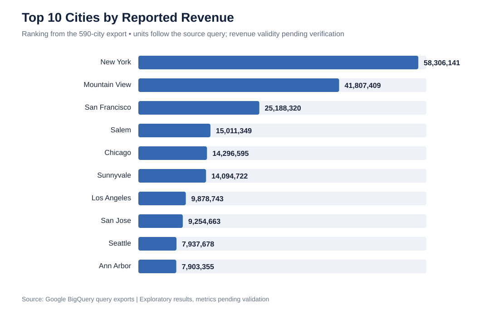
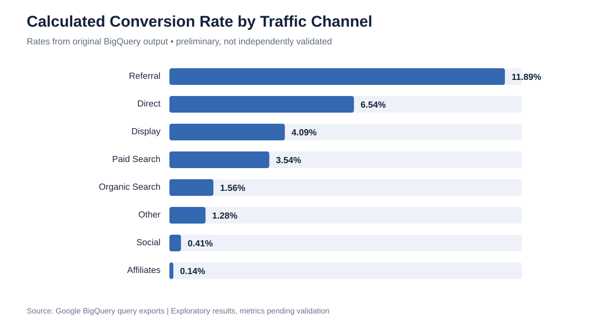

# E-commerce Sales & Conversion Analysis with Google BigQuery

Exploratory SQL analysis of a public e-commerce analytics dataset to examine geographic revenue, cart and checkout activity, transaction-session percentages, product rankings, and conversion rates by traffic channel.

**Tools:** Google BigQuery · SQL (Standard SQL)  
**Dataset:** `data-to-insights.ecommerce.all_sessions` (Google public training data)  
**Status:** SQL exploration documented; metrics need validation. Looker Studio dashboard is not yet included.

## Business questions explored

1. Which cities generated the highest reported transaction revenue?
2. Which visitors added items to cart without a recorded checkout action?
3. What percentage of sessions were marked as transaction sessions under the query's definition?
4. Which products appear among the top 10 by reported units sold?
5. How do calculated conversion rates differ across acquisition channels?

## Queries

| Analysis | SQL |
| --- | --- |
| City-level reported revenue | [`01_revenue_by_city.sql`](sql/01_revenue_by_city.sql) |
| Visitors with cart activity but no checkout action | [`02_cart_without_checkout_by_visitor.sql`](sql/02_cart_without_checkout_by_visitor.sql) |
| Transaction-session percentage | [`03_transaction_session_percentage.sql`](sql/03_transaction_session_percentage.sql) |
| Traffic-channel conversion | [`04_traffic_channel_conversion.sql`](sql/04_traffic_channel_conversion.sql) |
| Top products by units sold | [`05_top_products_by_units_sold.sql`](sql/05_top_products_by_units_sold.sql) |

The five SQL files were transcribed and formatted from screenshots of completed BigQuery runs. They have **not been independently rerun** as part of preparing this repository.

## Exported result tables and portfolio charts

The user-provided BigQuery CSV exports support the following shareable summaries:

| Analysis | Result summary | Visualization |
| --- | --- | --- |
| City revenue | [Top 10 cities (CSV)](results/revenue_by_city_top10.csv) | [Revenue chart](visualizations/top_cities_revenue.svg) |
| Product sales | [Top 10 products (CSV)](results/top10_products.csv) | [Product chart](visualizations/top_products_units.svg) |
| Channel performance | [Channel result (CSV)](results/traffic_channel_conversion.csv) | [Conversion rate chart](visualizations/channel_conversion_rate.svg) |
| Transaction-session percentage | [One-row result (CSV)](results/transaction_session_percentage.csv) | Not charted; reported output: 4.48% |
| Visitor cart analysis | [Aggregated visitor count (CSV)](results/cart_without_checkout_summary.csv) | No visitor-ID chart published |

### Visual summaries

**Privacy and integrity notes:** The full visitor-level cart export (28,149 rows of visitor identifiers) has not been published. The source city revenue export has 590 rows; only the top 10 are included in the public summary table, while the SQL query itself analyzes all cities. These SVG charts were reconstructed from the exported CSV values to make the graphics easier to read; they are not screenshots of a Looker Studio dashboard. They visualize preliminary results, **not independently validated revenue or conversion KPIs**.

## Selected observed results

- The city-revenue result ranked **New York**, **Mountain View**, and **San Francisco** highest among the visible rows. BigQuery displayed values in scientific notation (e.g., `5.830614071E7` for New York after the query's 1,000,000 divisor).
- The transaction-session percentage query displayed **4.48%**.
- In the channel breakdown, the screenshot showed calculated conversion rates of **Referral 11.89%**, **Direct 6.54%**, and **Organic Search 1.56%**.
- The products result showed **Maze Pen** (17,983 units) and **Google 22 oz Water Bottle** (16,221 units) among the leading items.

**Caution:** These are results observed in screenshots, not independently validated business KPIs. Session identifiers, duplicated rows, event semantics, and revenue units must be checked. Read [metric validation notes](docs/metric_validation.md) before citing these numbers.

## How to reproduce

1. Open [Google BigQuery Studio](https://console.cloud.google.com/bigquery).
2. Select a Google Cloud project with BigQuery access and confirm any required billing configuration.
3. Open a SQL file from the [`sql/`](sql/) folder and run it in a BigQuery editor tab.
4. Confirm that the public table `data-to-insights.ecommerce.all_sessions` is accessible.
5. Validate definitions and source-table grain before treating results as business KPIs.

> BigQuery query processing may incur costs. This repository contains no credentials or raw visitor-level exports. The included CSVs are summarized query results.

## Work completed and next steps

**Included:** Five SQL scripts transcribed from source screenshots, selected CSV result summaries, and three clean SVG visualizations.  
**Still to validate:** session-level deduplication and the meaning of revenue, transaction, and conversion fields.  
**Still to add:** Original query screenshots and the Looker Studio dashboard link/screenshots when available.

## Dataset attribution

Uses publicly available Google training data described in [Exploring an Ecommerce Dataset using SQL in Google BigQuery](https://www.skills.google/focuses/49138?parent=catalog). No source data is redistributed.

This is an educational portfolio project, not a claim of commercial business impact.
